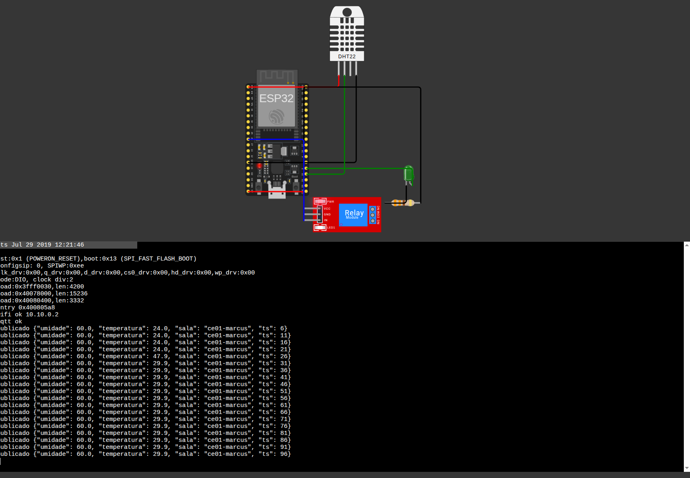
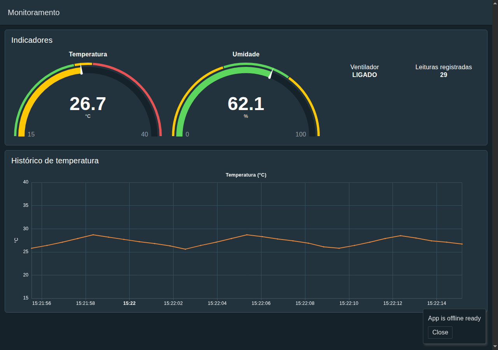

# Sala inteligente: monitoramento e ventilação automática

Projeto da disciplina Fundamentos de Internet das Coisas (IoT), Universidade de Fortaleza.

Um ESP32 mede temperatura e umidade de uma sala de aula e envia os dados por MQTT. O Node-RED recebe, guarda o histórico, mostra um painel e liga ou desliga o ventilador conforme a temperatura.

- Autor: Marcus Túlio Moreira Prudêncio Filho (matrícula 2425039)
- Circuito no Wokwi: https://wokwi.com/projects/480418732900234241

## Problema

Em salas com ventilação manual, a temperatura sobe ao longo do turno e ninguém acompanha. O ventilador é ligado tarde, ou fica ligado sem necessidade, e não existe registro do que aconteceu.

## Como funciona

```
Wokwi (ESP32 + DHT22 + relé + LED)
        |  ^
leituras|  |comando LIGAR / DESLIGAR
        v  |
   broker.hivemq.com (MQTT)
        |  ^
        v  |
Node-RED --> painel (localhost:1880/dashboard/monitor)
        |
        v
   leituras.csv (histórico)
```

1. O ESP32 lê o DHT22 a cada 5 segundos e publica as leituras.
2. O Node-RED recebe, valida, grava no CSV e atualiza o painel.
3. A regra de automação decide se o ventilador deve mudar de estado e publica o comando.
4. O ESP32 recebe o comando, aciona o relé e o LED e publica o estado atual.

### Regra de automação

| Condição | Ação |
|---|---|
| Temperatura maior ou igual a 28 °C com ventilador desligado | Envia LIGAR |
| Temperatura menor ou igual a 26 °C com ventilador ligado | Envia DESLIGAR |
| Entre 26 e 28 °C | Mantém o estado |

A faixa de 2 °C evita que o relé fique ligando e desligando perto do limite. O comando só é enviado quando o estado muda.

### Tópicos MQTT

| Tópico | Sentido | Conteúdo |
|---|---|---|
| `unifor/iot/sala/<sala>/sensores` | ESP32 para Node-RED | Leitura (QoS 0) |
| `unifor/iot/sala/<sala>/ventilador/comando` | Node-RED para ESP32 | LIGAR ou DESLIGAR (QoS 1) |
| `unifor/iot/sala/<sala>/ventilador/estado` | ESP32 para Node-RED | Estado atual, retido |

Formato das mensagens (JSON):

```json
{"sala":"ce01","temperatura":27.6,"umidade":62.6,"ts":1794421102}
{"acao":"LIGAR","motivo":"temperatura >= 28","ts":"2026-11-11T18:22:09.000Z"}
{"ligado":true,"ts":1794421103}
```

### Circuito

| Componente | Pino |
|---|---|
| DHT22 (sensor) | GPIO 15 |
| Módulo de relé (ventilador) | GPIO 26 |
| LED (indicador) | GPIO 2 |

## Evidências

### ESP32 no Wokwi

Conectado ao Wi-Fi e ao broker, publicando as leituras a cada 5 segundos.



### Painel no Node-RED

Temperatura, umidade, estado do ventilador, total de leituras e gráfico do histórico.



### Resultados do teste

Execução de bancada com um dispositivo simulado em Node.js, com o tempo acelerado (uma leitura a cada 0,7 s).

| Indicador | Resultado |
|---|---|
| Leituras registradas | 46 |
| Temperatura mínima, média e máxima | 25,6 °C, 27,2 °C e 28,7 °C |
| Umidade mínima, média e máxima | 56,7 %, 61,4 % e 64,3 % |
| Comandos emitidos | 9 (5 LIGAR e 4 DESLIGAR) |

Todos os comandos saíram exatamente nos limites de 28 °C e 26 °C. Os registros completos estão em `evidencias/`:

- `log-mqtt.txt`: mensagens trocadas no broker.
- `log-dispositivo.txt`: comandos recebidos pelo dispositivo.
- `dashboard-wokwi.png`: painel recebendo dados do Wokwi.

No Wokwi, o mesmo código publicou as leituras no broker público e executou os comandos de LIGAR e DESLIGAR enviados pelo Node-RED.

## Como executar

**Wokwi:** crie um projeto ESP32 com MicroPython, copie `wokwi/main.py` e `wokwi/diagram.json` e clique em Play. Mude o valor de `SALA` no `main.py` para um nome só seu, porque o broker é público.

**Node-RED:**

```bash
cd simulacao && npm install && cd ..
cd nodered
../simulacao/node_modules/.bin/node-red -u "$PWD/userdir" -s "$PWD/settings.js"
```

Painel: `http://localhost:1880/dashboard/monitor`. Se mudar o nome da sala, ajuste os tópicos nos nós MQTT de `nodered/flows-wokwi.json`.

**Teste sem Wokwi:** em `simulacao/`, rode `node broker.js` e `node dispositivo.js` e use `nodered/flows.json`, que aponta para o broker local.

## Segurança e privacidade

| Risco | Mitigação |
|---|---|
| Broker público sem autenticação | Em produção, usar broker próprio com usuário, senha, TLS e permissões por tópico |
| Comando forjado liga ou desliga o equipamento | Restringir quem publica no tópico de comando; o dispositivo ignora ações desconhecidas |
| Mensagem malformada | O Node-RED descarta leituras inválidas e o dispositivo ignora comandos inválidos |
| Privacidade | Só há dados ambientais, sem câmera, microfone nem identificação de pessoas |

## Limitações

- O broker público serve só para a simulação.
- A temperatura simulada não tem inércia térmica real.
- Há um único sensor; uma sala real precisaria de vários pontos.
- O CSV atende à demonstração; para uso contínuo, um banco de séries temporais seria melhor.

## Estrutura

```
wokwi/          código e circuito do ESP32
nodered/        fluxos (Wokwi e teste local) e configuração
simulacao/      broker e dispositivo simulados para teste local
evidencias/     capturas e registros dos testes
relatorio/      relatório em HTML e PDF
```
